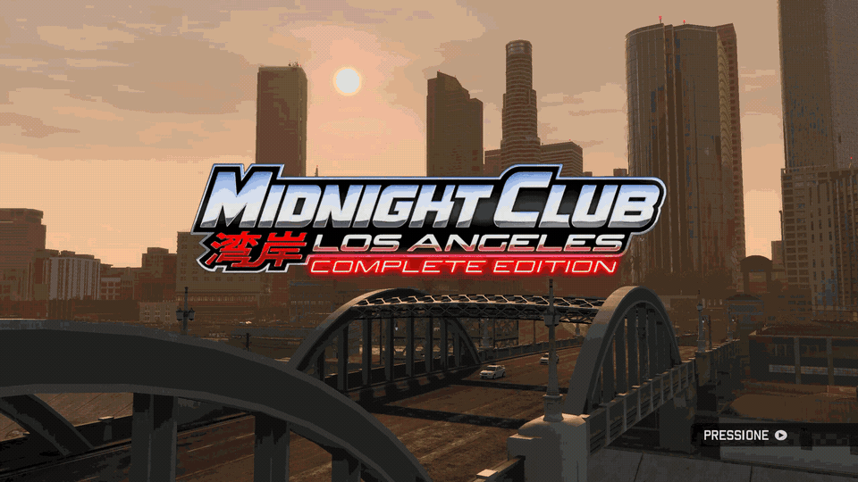
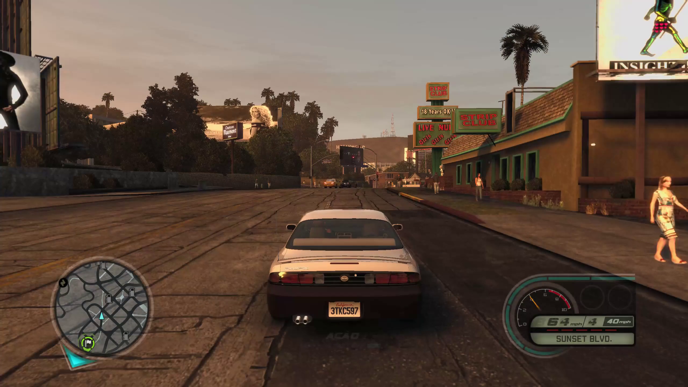
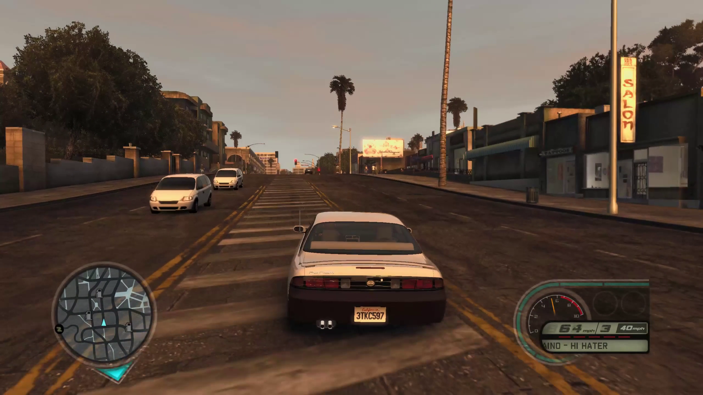
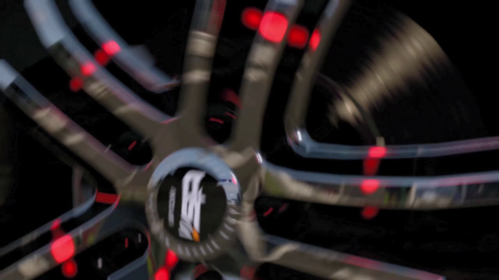
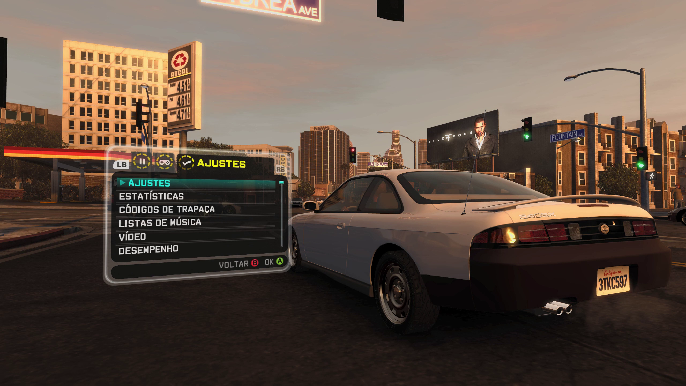

<div align="center">

# Midnight Club: Los Angeles - Recompiled

[](#caso-você-seja-um-nerdão)
[](#caso-você-seja-um-nerdão)
[](#opções-e-recursos)
[](#opções-e-recursos)
[-green?style=flat-square)](#opções-e-recursos)

<br />


<br /><br />

[Como Jogar](#como-jogar) • [Opções e Recursos](#opções-e-recursos) • [Galeria](#galeria) • [Caso você seja um nerdão](#caso-você-seja-um-nerdão)

</div>

---

## Sobre o Projeto

*Midnight Club: Los Angeles - Recompiled* é um porte nativo para computador desenvolvido através de recompilação estática dos binários originais de console.

Em vez de depender de emulação convencional, o código executável do jogo foi traduzido para rodar diretamente sobre o Windows e a API DirectX 12. O resultado é um executável de alto desempenho, com carregamento rápido e integração completa com placas de vídeo modernas.

---

## Galeria

<div align="center">
  
</div>

<br />

<div align="center">
  
  
</div>

<div align="center">
  
  
</div>

---

## Opções e Recursos

- **Taxas de Quadros Flexíveis:**
  - **60 FPS Travados:** Recomendado para a melhor experiência geral, garantindo alta eficiência de hardware (consumo reduzido de GPU) e física perfeitamente estável.
  - **Modo Desbloqueado:** Para quem possui hardware e poder de processamento sobrando, alcançando 90 a 100+ FPS fluidos na corrida.
- **Resoluções Nativas:** Suporte a 1080p, 1440p (2K) e 4K.
- **Renderização DirectX 12:** Pipeline gráfico moderno direto na GPU, com suporte a Anti-Aliasing (FXAA) e alta fidelidade de imagem.
- **Cinemáticas e Cutscenes:** Vídeos em formato Bink reproduzidos nativamente com áudio estéreo sincronizado.
- **Tradução em Português (PT-BR):** Menus principais, interface de opções, HUD e legendas traduzidos.
- **Launcher Integrado:** Utilitário visual para gerenciar configurações, criar atalhos e extrair os arquivos do jogo a partir da ISO original com um clique.

---

## Como Jogar

### Pré-requisitos
- Windows 10 ou Windows 11 (64-bit)
- Placa de vídeo com suporte a DirectX 12
- Arquivo de imagem original do jogo (`.iso`) para Xbox 360

### Instalação Rápida
1. Baixe o pacote da versão mais recente na aba [Releases](../../releases).
2. Extraia o arquivo `.zip` em uma pasta no seu computador.
3. Execute o `MidnightClubLALauncher.exe`.
4. Na aba **Config**, selecione o arquivo `.iso` original do jogo e clique em **Extrair Jogo**.
5. Na aba **Jogar**, escolha sua resolução preferida e inicie a partida.

---

## Caso você seja um nerdão

Se você quer entender a arquitetura do projeto, ver as tecnologias utilizadas ou rodar o executável diretamente via linha de comando:

### Tecnologias Utilizadas

- **C++20 & LLVM / Clang 18+:** Compilação do código nativo gerado a partir da tradução dos binários.
- **ReXGlue SDK:** Framework de recompilação estática responsável pela tradução do binário PowerPC (`default.xex`) para x86_64 e pelo runtime de abstração de chamadas do sistema operacional.
- **DirectX 12 (D3D12):** Backend gráfico de baixo nível, responsável pelo mapeamento das chamadas de desenho do Xenos GPU diretamente em Render Target Views (RTV) do Windows.
- **WPF (.NET Framework 4.8 / C#):** Interface gráfica do Launcher para gerenciamento de configurações e automação de processos.
- **extract-xiso:** Utilitário embutido para parsing e extração direta do sistema de arquivos das imagens de disco do Xbox 360.
- **Bink Video:** Subsistema de decodificação e streaming de cutscenes e vídeos em tempo real.

---

### Execução via Linha de Comando (Flags e Parâmetros)

Se preferir rodar o jogo direto pelo terminal sem abrir o Launcher, execute o binário passando os argumentos desejados:

```powershell
.\out\build\win-amd64-release\midnight_club_la.exe `
  --mcla_ptbr=true `
  --mcla_fps=60 `
  --resolution_scale=2 `
  --fullscreen=true `
  --vsync=false `
  --mcla_anti_aliasing=fxaa `
  --render_target_path_d3d12=rtv
```

#### Principais Flags de Configuração:

| Flag | Valores | Descrição |
| :--- | :--- | :--- |
| `--resolution_scale` | `1`, `2`, `3` | Multiplicador de resolução interna (`1` = 1080p, `2` = 1440p / 2K, `3` = 4K). |
| `--mcla_fps` | `60`, `120`, `0` | Limite de taxa de quadros (`60` para física estável, `0` ou `120` para desbloqueado). |
| `--mcla_ptbr` | `true`, `false` | Ativa ou desativa a localização em Português do Brasil. |
| `--mcla_anti_aliasing` | `fxaa`, `off` | Modo de anti-aliasing aplicado na imagem. |
| `--fullscreen` | `true`, `false` | Alterna entre modo de tela cheia exclusiva e modo janela. |
| `--vsync` | `true`, `false` | Sincronização vertical com a taxa de atualização do monitor. |
| `--render_target_path_d3d12` | `rtv` | Utiliza Render Target Views diretas do DirectX 12. |
| `--edram_tiles` | `2048` | Quantidade de tiles alocados para emulação de memória eDRAM. |
| `--mcla_cache_flush` | `fence` | Gerenciamento de sincronização de cache de comandos da GPU. |

---

### Compilação a partir do Código-Fonte

Para compilar o projeto do zero:

**Ferramentas necessárias:** Clang 18+ (LLVM), CMake 3.25+, Ninja e Visual Studio 2022 (para C# e Windows SDK).

```powershell
# 1. Gerar os arquivos do SDK a partir do executável original extraído
rexglue init --force --project_name midnight_club_la --project_root . --xex_path game\default.xex --game_root game

# 2. Compilar o executável nativo do jogo
cmake --preset win-amd64-release -DREXSDK_DIR=thirdparty\rexglue-sdk
cmake --build out\build\win-amd64-release

# 3. Compilar o Launcher
MSBuild.exe launcher\MidnightClubLALauncher\MidnightClubLALauncher.csproj /p:Configuration=Release /p:Platform=AnyCPU
```

---

## Aviso Legal

Este projeto tem fins educacionais e de preservação histórica de software. Nenhum arquivo proprietário, áudio, modelo 3D, vídeo ou código protegido por direitos autorais é distribuído neste repositório. O usuário deve fornecer seus próprios arquivos a partir de uma cópia original do jogo adquirida legalmente.
